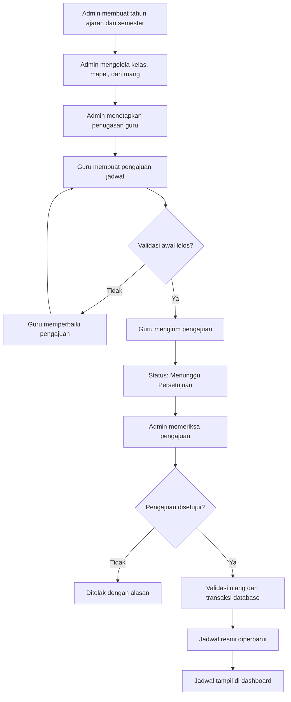
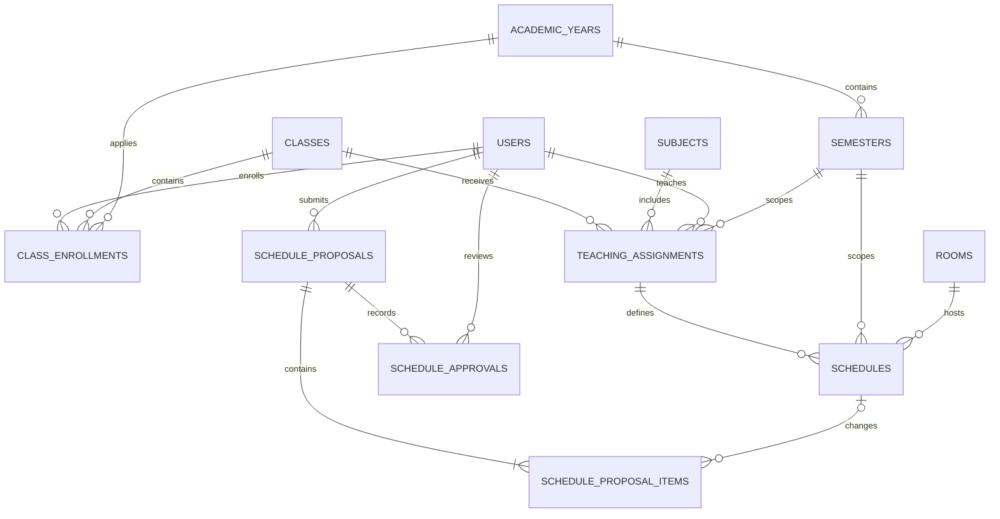

# Rancangan Modul Jadwal Pelajaran
## Satu-Sekolah

**Versi:** 1.0  
**Jenis dokumen:** Rancangan fungsional dan teknis  
**Modul:** Manajemen Jadwal Pelajaran

---

## 1. Ringkasan

Modul Jadwal Pelajaran merupakan bagian dari sistem Satu-Sekolah yang digunakan untuk mengelola jadwal pelajaran berdasarkan kelas, mata pelajaran, guru, ruang, tahun ajaran, dan semester.

Sistem menggunakan mekanisme pengajuan jadwal oleh guru dan persetujuan oleh admin. Siswa hanya dapat melihat jadwal resmi sesuai kelas dan periode akademiknya.

### Keputusan utama

1. Guru mengajukan jadwal atau perubahan jadwal.
2. Admin memeriksa dan menyetujui atau menolak pengajuan.
3. Setiap kelas dapat memiliki susunan mata pelajaran dan jadwal yang berbeda.
4. Jadwal terikat pada tahun ajaran dan semester.
5. Jadwal yang belum disetujui tidak ditampilkan sebagai jadwal resmi.
6. Riwayat jadwal dan perubahan tetap tersimpan.

## 2. Tujuan dan Ruang Lingkup

### 2.1 Tujuan

- Menampilkan jadwal sesuai kelas siswa.
- Menampilkan jadwal mengajar berdasarkan penugasan guru.
- Mencegah bentrok jadwal guru, kelas, dan ruang.
- Menyediakan proses pengajuan dan persetujuan jadwal.
- Menyimpan riwayat jadwal berdasarkan tahun ajaran dan semester.
- Mencatat perubahan jadwal untuk keperluan audit.

### 2.2 Fitur dalam cakupan

- Pengelolaan tahun ajaran dan semester.
- Pengelolaan kelas, mata pelajaran, ruang, dan penugasan guru.
- Pengajuan jadwal baru oleh guru.
- Pengajuan perubahan dan pembatalan jadwal.
- Validasi bentrok jadwal.
- Persetujuan atau penolakan oleh admin.
- Tampilan jadwal siswa dan guru.
- Riwayat pengajuan dan perubahan.

### 2.3 Di luar cakupan awal

- Pembuatan jadwal otomatis menggunakan AI.
- Absensi otomatis berdasarkan jadwal.
- Integrasi dengan kalender eksternal.
- Pengiriman notifikasi melalui WhatsApp.

Fitur di luar cakupan dapat ditambahkan pada pengembangan berikutnya.

---

## 3. Hak Akses Pengguna

| Fitur | Siswa | Guru | Admin |
|---|---|---|---|
| Melihat jadwal kelas | Ya | Ya | Ya |
| Melihat jadwal mengajar sendiri | Tidak | Ya | Ya |
| Membuat pengajuan jadwal | Tidak | Ya | Ya, sesuai kebijakan |
| Mengirim pengajuan | Tidak | Ya | Ya, sesuai kebijakan |
| Mengubah jadwal resmi secara langsung | Tidak | Tidak | Melalui proses resmi |
| Menyetujui pengajuan | Tidak | Tidak | Ya |
| Menolak pengajuan | Tidak | Tidak | Ya |
| Mengelola tahun ajaran | Tidak | Tidak | Ya |
| Mengelola semester | Tidak | Tidak | Ya |
| Mengelola kelas dan mata pelajaran | Tidak | Terbatas | Ya |
| Melihat riwayat seluruh pengajuan | Tidak | Pengajuan sendiri | Ya |

**Ketentuan keamanan:** seluruh hak akses wajib diperiksa di backend. Menyembunyikan tombol pada antarmuka saja tidak cukup untuk mengamankan data.

---

## 4. Alur Kerja Sistem

### 4.1 Alur utama

1. Admin membuat tahun ajaran dan semester.
2. Admin mengelola data kelas, mata pelajaran, dan ruang.
3. Admin menetapkan penugasan guru untuk kelas dan mata pelajaran tertentu.
4. Guru membuka halaman Jadwal Mengajar.
5. Guru membuat draft pengajuan jadwal.
6. Sistem memvalidasi kelengkapan dan kemungkinan bentrok.
7. Guru mengirim pengajuan kepada admin.
8. Status pengajuan berubah menjadi `pending`.
9. Admin memeriksa detail pengajuan dan peringatan bentrok.
10. Admin menyetujui atau menolak pengajuan.
11. Jika ditolak, admin wajib memberikan alasan.
12. Jika disetujui, sistem melakukan validasi ulang dan menyimpan perubahan menggunakan transaksi database.
13. Jadwal resmi diperbarui.
14. Jadwal yang telah disetujui ditampilkan kepada siswa dan guru yang terkait.

### 4.2 Diagram alur



---

## 5. Struktur Database

Struktur berikut merupakan rancangan konseptual yang dapat diterapkan menggunakan Laravel dan MySQL atau PostgreSQL.

### 5.1 Tabel `users`

Menyimpan akun pengguna.

| Kolom | Fungsi |
|---|---|
| `id` | Primary key |
| `name` | Nama pengguna |
| `email` | Email pengguna |
| `role` | Peran pengguna |
| `status` | Status akun |
| `created_at` | Waktu pembuatan |
| `updated_at` | Waktu perubahan |

Peran pengguna minimal mencakup siswa, guru, dan admin. Peran lain dalam sistem Satu-Sekolah tetap dapat menggunakan tabel pengguna yang sama.

### 5.2 Tabel `classes`

Menyimpan data kelas.

| Kolom | Fungsi |
|---|---|
| `id` | Primary key |
| `name` | Nama kelas, contoh XI RPL 1 |
| `grade_level` | Tingkat kelas |
| `major` | Jurusan |
| `status` | Status kelas |
| `created_at` | Waktu pembuatan |
| `updated_at` | Waktu perubahan |

### 5.3 Tabel `class_enrollments`

Menghubungkan siswa dengan kelas pada tahun ajaran tertentu.

| Kolom | Fungsi |
|---|---|
| `id` | Primary key |
| `student_id` | Relasi ke pengguna siswa |
| `class_id` | Relasi ke kelas |
| `academic_year_id` | Tahun ajaran |
| `status` | Status penempatan |
| `created_at` | Waktu pembuatan |
| `updated_at` | Waktu perubahan |

Tabel ini penting karena siswa dapat naik kelas pada tahun ajaran berikutnya. Jangan hanya menyimpan `class_id` permanen pada tabel `users`, karena riwayat kelas akan sulit ditelusuri.

Sistem perlu memastikan seorang siswa tidak memiliki dua penempatan kelas aktif yang bertentangan pada tahun ajaran yang sama.

### 5.4 Tabel `subjects`

Menyimpan data mata pelajaran.

| Kolom | Fungsi |
|---|---|
| `id` | Primary key |
| `name` | Nama mata pelajaran |
| `code` | Kode mata pelajaran |
| `status` | Status mata pelajaran |

Contoh mata pelajaran: PKN, IPA, PAI, dan Bahasa Indonesia.

### 5.5 Tabel `academic_years`

Menyimpan tahun ajaran.

| Kolom | Fungsi |
|---|---|
| `id` | Primary key |
| `name` | Contoh 2026/2027 |
| `start_date` | Tanggal mulai |
| `end_date` | Tanggal selesai |
| `status` | Status tahun ajaran |

### 5.6 Tabel `semesters`

Menyimpan semester dalam suatu tahun ajaran.

| Kolom | Fungsi |
|---|---|
| `id` | Primary key |
| `academic_year_id` | Relasi tahun ajaran |
| `name` | Ganjil atau Genap |
| `start_date` | Tanggal mulai |
| `end_date` | Tanggal selesai |
| `status` | Status semester |

### 5.7 Tabel `rooms`

Menyimpan data ruang belajar.

| Kolom | Fungsi |
|---|---|
| `id` | Primary key |
| `name` | Nama atau kode ruang |
| `capacity` | Kapasitas ruang |
| `status` | Status ruang |

### 5.8 Tabel `teaching_assignments`

Menentukan guru yang mengajar mata pelajaran pada kelas tertentu dalam suatu semester.

| Kolom | Fungsi |
|---|---|
| `id` | Primary key |
| `teacher_id` | ID guru |
| `class_id` | ID kelas |
| `subject_id` | ID mata pelajaran |
| `semester_id` | ID semester |
| `status` | Status penugasan |
| `created_at` | Waktu pembuatan |
| `updated_at` | Waktu perubahan |

Contoh: Guru A mengajar PKN di XI RPL 2 pada semester ganjil tahun ajaran 2026/2027.

Guru hanya boleh membuat pengajuan untuk penugasan mengajar yang sah.

### 5.9 Tabel `schedules`

Menyimpan jadwal resmi yang telah disetujui.

| Kolom | Fungsi |
|---|---|
| `id` | Primary key |
| `teaching_assignment_id` | Relasi penugasan guru |
| `semester_id` | Relasi semester |
| `room_id` | Relasi ruang |
| `day_of_week` | Hari pelajaran |
| `start_time` | Jam mulai |
| `end_time` | Jam selesai |
| `effective_from` | Awal masa berlaku, opsional |
| `effective_until` | Akhir masa berlaku, opsional |
| `status` | Status jadwal |
| `created_at` | Waktu pembuatan |
| `updated_at` | Waktu perubahan |

Status jadwal resmi:

- `active`: jadwal aktif.
- `inactive`: jadwal tidak aktif.
- `replaced`: jadwal sudah digantikan jadwal lain.

Hari harus menggunakan konvensi yang konsisten. Contoh: Senin = 1 sampai Minggu = 7.

### 5.10 Tabel `schedule_proposals`

Menyimpan pengajuan jadwal dari guru.

| Kolom | Fungsi |
|---|---|
| `id` | Primary key |
| `proposer_id` | ID pengaju |
| `semester_id` | ID semester |
| `proposal_type` | Jenis pengajuan |
| `status` | Status pengajuan |
| `reason` | Alasan pengajuan |
| `submitted_at` | Waktu pengiriman |
| `reviewed_at` | Waktu peninjauan |
| `created_at` | Waktu pembuatan |
| `updated_at` | Waktu perubahan |

Jenis pengajuan:

- `create`: membuat jadwal baru.
- `update`: mengubah jadwal.
- `cancel`: mengajukan pembatalan jadwal.

Status pengajuan:

- `draft`
- `pending`
- `approved`
- `rejected`

### 5.11 Tabel `schedule_proposal_items`

Menyimpan rincian jadwal yang diajukan. Satu pengajuan dapat berisi satu atau beberapa perubahan.

| Kolom | Fungsi |
|---|---|
| `id` | Primary key |
| `proposal_id` | Relasi pengajuan |
| `schedule_id` | Jadwal resmi yang diubah, nullable |
| `change_type` | Jenis perubahan |
| `proposed_teaching_assignment_id` | Penugasan guru yang diusulkan |
| `proposed_room_id` | Ruang yang diusulkan |
| `proposed_day_of_week` | Hari yang diusulkan |
| `proposed_start_time` | Jam mulai yang diusulkan |
| `proposed_end_time` | Jam selesai yang diusulkan |
| `change_reason` | Alasan perubahan |
| `created_at` | Waktu pembuatan |
| `updated_at` | Waktu perubahan |

Untuk jadwal baru, `schedule_id` bernilai `NULL`. Untuk perubahan jadwal, kolom tersebut menunjuk ke jadwal resmi yang akan diubah.

### 5.12 Tabel `schedule_approvals`

Menyimpan riwayat keputusan admin.

| Kolom | Fungsi |
|---|---|
| `id` | Primary key |
| `proposal_id` | ID pengajuan |
| `reviewer_id` | ID admin yang meninjau |
| `decision` | `approved` atau `rejected` |
| `note` | Catatan atau alasan keputusan |
| `reviewed_at` | Waktu keputusan |

### 5.13 Tabel `audit_logs`

Mencatat aktivitas penting pada sistem.

| Kolom | Fungsi |
|---|---|
| `id` | Primary key |
| `actor_id` | Pengguna yang melakukan aksi |
| `action` | Jenis aksi |
| `entity_type` | Jenis data yang diubah |
| `entity_id` | ID data terkait |
| `before_data` | Data sebelum perubahan |
| `after_data` | Data setelah perubahan |
| `created_at` | Waktu aktivitas |

Audit log digunakan untuk menelusuri siapa yang mengajukan, menyetujui, menolak, atau mengubah jadwal.

### 5.14 Diagram ERD



Diagram ini merupakan gambaran konseptual. Implementasi tetap perlu menambahkan foreign key, indeks, dan constraint yang sesuai.

---

## 6. Aturan Bisnis dan Validasi

### 6.1 Validasi dasar

- Jam selesai harus lebih besar daripada jam mulai.
- Hari, ruang, semester, kelas, mata pelajaran, dan guru harus valid.
- Penugasan mengajar harus aktif dan sesuai semester pengajuan.
- Jadwal harus berada dalam periode yang diizinkan.
- Guru hanya boleh mengajukan jadwal untuk penugasannya sendiri, kecuali admin memiliki hak khusus.
- Pengajuan yang sudah disetujui atau ditolak tidak boleh diedit kembali.
- Perubahan setelah persetujuan harus dibuat sebagai pengajuan baru.
- Penolakan oleh admin wajib menyertakan alasan.

### 6.2 Pemeriksaan bentrok

Sistem harus memeriksa tiga jenis bentrok.

**1. Bentrok guru**

Guru yang sama tidak boleh mengajar dua kelas dalam waktu yang bertabrakan.

**2. Bentrok kelas**

Kelas yang sama tidak boleh mengikuti dua mata pelajaran pada waktu yang bertabrakan.

**3. Bentrok ruang**

Ruang yang sama tidak boleh digunakan untuk dua kegiatan pelajaran pada waktu yang bertabrakan.

Rumus pemeriksaan tumpang tindih waktu:

```text
A_start < B_end AND B_start < A_end
```

Contoh:

- Pelajaran A: 08.00 sampai 10.00.
- Pelajaran B: 09.30 sampai 11.00.

Keduanya bertabrakan.

Sebaliknya, pelajaran A yang selesai pukul 10.00 boleh diikuti pelajaran B yang mulai tepat pukul 10.00.

Pengecualian penggunaan ruang bersama harus diatur secara eksplisit, bukan dibiarkan berdasarkan asumsi.

### 6.3 Waktu pelaksanaan validasi

Validasi dilakukan ketika:

1. Guru menyimpan draft.
2. Guru mengirim pengajuan.
3. Admin meninjau pengajuan.
4. Admin menyetujui pengajuan.

Validasi terakhir harus dilakukan ulang ketika persetujuan diproses, di dalam transaksi database. Hal ini mencegah dua admin menyetujui jadwal yang bertabrakan pada waktu hampir bersamaan.

Saat jadwal diubah, jadwal lama yang sedang diubah harus dikecualikan dari pemeriksaan konflik terhadap dirinya sendiri.

### 6.4 Pemisahan status

Status pengajuan berbeda dari status jadwal resmi.

Contoh: jadwal resmi lama tetap aktif ketika pengajuan perubahan masih menunggu persetujuan.

Jika pengajuan ditolak, jadwal resmi tidak berubah.

Jika pengajuan disetujui, sistem menerapkan perubahan, menandai jadwal lama sebagai digantikan bila relevan, lalu menyimpan jadwal baru sesuai hasil persetujuan.

---

## 7. Rancangan Antarmuka

### 7.1 Halaman guru

Menu:

- Jadwal Mengajar.
- Pengajuan Jadwal.
- Buat Pengajuan.
- Riwayat Pengajuan.

Informasi yang ditampilkan:

- Jadwal mingguan.
- Jumlah jadwal aktif.
- Jumlah pengajuan yang menunggu persetujuan.
- Pengajuan yang ditolak.
- Catatan atau alasan dari admin.

Formulir pengajuan mencakup:

- Semester.
- Penugasan mengajar.
- Jenis pengajuan.
- Hari.
- Jam mulai.
- Jam selesai.
- Ruang.
- Alasan perubahan.

Guru tidak dapat mengubah jadwal resmi secara langsung.

### 7.2 Halaman admin

Menu:

- Antrean Persetujuan.
- Jadwal Resmi.
- Riwayat Persetujuan.
- Pengaturan Tahun Ajaran dan Semester.

Fitur:

- Filter tahun ajaran dan semester.
- Filter guru dan kelas.
- Filter status pengajuan.
- Tampilan jadwal lama dan jadwal usulan.
- Peringatan bentrok guru, kelas, atau ruang.
- Tombol Setujui.
- Tombol Tolak dengan alasan.
- Riwayat perubahan.

Sebelum menyetujui, sistem menampilkan seluruh konflik yang ditemukan. Backend tetap harus menjalankan validasi terakhir, meskipun antarmuka telah menyatakan jadwal aman.

### 7.3 Halaman siswa

Informasi yang ditampilkan:

- Jadwal hari ini.
- Jadwal mingguan.
- Mata pelajaran.
- Nama guru.
- Jam mulai dan selesai.
- Ruang kelas.
- Pemilih tahun ajaran dan semester.

Periode aktif menjadi pilihan awal.

Siswa hanya melihat jadwal resmi berdasarkan penempatan kelas pada tahun ajaran yang dipilih. Siswa tidak boleh melihat jadwal kelas lain hanya dengan mengubah parameter URL atau ID kelas.

---

## 8. Contoh Perilaku Sistem

### Kasus 1: Dua siswa berbeda kelas

Siswa A terdaftar di XI RPL 2. Jadwal kelas tersebut adalah:

| Hari | Jam | Mata Pelajaran |
|---|---|---|
| Senin | 07.00–08.30 | PKN |
| Senin | 08.30–10.00 | IPA |

Siswa B terdaftar di XI RPL 1. Jadwal kelas tersebut adalah:

| Hari | Jam | Mata Pelajaran |
|---|---|---|
| Senin | 07.00–08.30 | PAI |
| Senin | 08.30–10.00 | Bahasa Indonesia |

Ketika masuk ke dashboard, Siswa A melihat jadwal XI RPL 2, sedangkan Siswa B melihat jadwal XI RPL 1.

Jadwal tidak dibuat ulang secara terpisah untuk setiap siswa. Sistem menentukan jadwal dari kelas tempat siswa terdaftar.

### Kasus 2: Guru mengajukan perubahan

Guru mengajukan perubahan jadwal dari Senin pukul 08.00 menjadi Selasa pukul 10.00.

Sebelum pengajuan disetujui, siswa tetap melihat jadwal Senin yang lama.

Setelah admin menyetujui dan validasi terakhir berhasil, sistem memperbarui jadwal resmi.

### Kasus 3: Jadwal bentrok

Guru A sudah mengajar kelas XI RPL 1 pada Senin pukul 08.00–09.00.

Guru tersebut mengajukan jadwal XI RPL 2 pada Senin pukul 08.30–09.30.

Sistem menolak pengajuan karena terdapat bentrok waktu guru.

### Kasus 4: Pengajuan ditolak

Admin menolak pengajuan karena ruang tidak tersedia. Admin menuliskan alasan penolakan.

Guru dapat melihat alasan tersebut dan membuat pengajuan baru. Jadwal resmi lama tetap berlaku.

---

## 9. Keamanan dan Konsistensi Data

Ketentuan teknis:

- Autentikasi dan otorisasi dilakukan di backend.
- Guru hanya dapat mengelola pengajuan miliknya.
- Admin hanya dapat menyetujui pengajuan jika memiliki hak akses.
- Persetujuan menggunakan transaksi database.
- Persetujuan ganda harus dicegah dengan memeriksa status pengajuan di dalam transaksi.
- Riwayat jadwal lama tidak dihapus permanen ketika jadwal diganti.
- Semua masukan dan ID relasi divalidasi di server.
- Aktivitas penting dicatat pada audit log.
- Gunakan foreign key dan indeks untuk menjaga konsistensi serta performa.
- Terapkan aturan unik yang sesuai untuk mencegah penempatan siswa dan data penugasan yang duplikat.

---

## 10. Kriteria Penerimaan

Modul dianggap memenuhi kebutuhan dasar apabila:

1. Siswa XI RPL 1 hanya melihat jadwal resmi XI RPL 1.
2. Siswa XI RPL 2 hanya melihat jadwal resmi XI RPL 2.
3. Guru dapat melihat jadwal sesuai penugasan mengajarnya.
4. Guru dapat membuat draft dan mengirim pengajuan jadwal.
5. Jadwal resmi tidak berubah sebelum pengajuan disetujui.
6. Admin dapat menyetujui atau menolak pengajuan.
7. Penolakan menyimpan alasan yang dapat dilihat oleh pengaju.
8. Sistem menolak bentrok guru, kelas, dan ruang.
9. Sistem memvalidasi ulang ketika persetujuan diproses.
10. Sistem mencegah persetujuan ganda.
11. Jadwal lama tetap dapat ditelusuri berdasarkan tahun ajaran dan semester.
12. Perubahan dan keputusan tercatat di audit log.
13. Hak akses ditegakkan di backend.
14. Jadwal yang disetujui muncul pada dashboard pengguna yang tepat.

---

## 11. Urutan Implementasi

Tahap pengembangan yang disarankan:

1. Membuat master tahun ajaran dan semester.
2. Membuat master kelas, mata pelajaran, dan ruang.
3. Membuat penempatan siswa melalui `class_enrollments`.
4. Membuat penugasan guru melalui `teaching_assignments`.
5. Membuat jadwal resmi dan tampilan jadwal dasar.
6. Membuat pengajuan jadwal dan detail perubahan.
7. Mengimplementasikan validasi bentrok.
8. Membuat antrean persetujuan admin.
9. Mengimplementasikan transaksi database untuk persetujuan.
10. Menghubungkan jadwal resmi ke dashboard siswa dan guru.
11. Menambahkan audit log dan riwayat periode.
12. Melakukan pengujian akses, konflik waktu, dan persetujuan bersamaan.

---

## 12. Catatan Implementasi Laravel

Jika Satu-Sekolah menggunakan Laravel, pembagian implementasi dapat dibuat seperti berikut.

### Models

- `AcademicYear`
- `Semester`
- `SchoolClass`
- `ClassEnrollment`
- `Subject`
- `Room`
- `TeachingAssignment`
- `Schedule`
- `ScheduleProposal`
- `ScheduleProposalItem`
- `ScheduleApproval`
- `AuditLog`

Nama model dapat disesuaikan dengan struktur proyek yang sudah ada.

### Form Requests

Digunakan untuk memvalidasi input ketika:

- Membuat pengajuan.
- Memperbarui draft.
- Mengirim pengajuan.
- Memberikan keputusan persetujuan.

### Policies

Digunakan untuk memastikan:

- Guru hanya mengelola pengajuan miliknya.
- Guru hanya menggunakan penugasan mengajar yang sah.
- Siswa hanya mengakses jadwal kelas yang sesuai.
- Hanya admin berwenang yang dapat menyetujui atau menolak.

### Services atau Actions

Logika pemeriksaan bentrok dan penerapan persetujuan sebaiknya dipisahkan dari controller agar mudah diuji dan digunakan ulang.

### Database Transactions

Gunakan `DB::transaction()` saat admin menerapkan persetujuan. Validasi konflik dan perubahan jadwal harus dilakukan secara aman dalam proses tersebut.

### Pengujian

Minimal mencakup:

- Siswa tidak dapat mengakses jadwal kelas lain.
- Guru tidak dapat mengajukan penugasan guru lain.
- Jadwal yang bertabrakan ditolak.
- Pengajuan yang ditolak tidak mengubah jadwal resmi.
- Pengajuan yang disetujui memperbarui jadwal resmi.
- Pengajuan yang sudah diproses tidak dapat disetujui kembali.
- Riwayat semester sebelumnya tetap tersedia.

---

## 13. Penutup

Modul Jadwal Pelajaran Satu-Sekolah menggunakan jadwal berbasis kelas dan periode akademik. Guru mengajukan jadwal, admin memeriksa dan menyetujui, lalu sistem menampilkan jadwal resmi kepada pengguna yang tepat.

Rancangan ini menjadi dasar pengembangan modul. Detail migration, endpoint API, komponen antarmuka, dan aturan akademik perlu disesuaikan dengan struktur aplikasi serta kebijakan sekolah yang sebenarnya.
