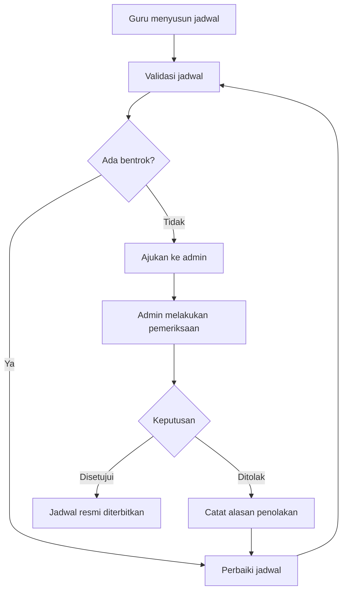
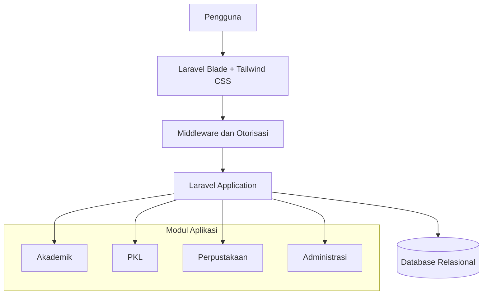

# Satu-Sekolah

<p align="center">
&#x20; <strong>One Platform. A Better School Experience.\</strong>
</p>

<p align="center">
&#x20; Sistem manajemen sekolah terpadu untuk menghubungkan kegiatan akademik, Praktik Kerja Lapangan (PKL), perpustakaan, dan administrasi dalam satu platform.
</p>

<p align="center">
  
  
  
  
</p>

<p align="center">
&#x20; <a href="#-fitur-utama">Fitur</a> ·
&#x20; <a href="#-arsitektur-sistem">Arsitektur</a> ·
&#x20; <a href="#-teknologi">Teknologi</a> ·
&#x20; <a href="#-instalasi">Instalasi</a> ·
&#x20; <a href="#-kontribusi">Kontribusi</a>
</p>

---

## Tentang Proyek

**Satu-Sekolah** adalah sistem manajemen sekolah berbasis web yang dirancang untuk menyederhanakan pengelolaan informasi dan aktivitas sekolah melalui satu platform terintegrasi.

Sistem ini memisahkan akses berdasarkan peran pengguna agar setiap pengguna hanya dapat mengakses fitur yang sesuai dengan tanggung jawabnya.

### Tujuan

- Menyatukan informasi akademik dan administrasi sekolah.
- Mempermudah pengelolaan tugas, absensi, dan jadwal pelajaran.
- Mendigitalisasi pencatatan kegiatan serta evaluasi PKL.
- Mengelola peminjaman dan pengembalian buku perpustakaan.
- Menyediakan kontrol akses yang konsisten dan aman.

## ✦ Fitur Utama

| Modul              | Deskripsi                                                                        |
| ------------------ | -------------------------------------------------------------------------------- |
| Akademik           | Informasi kelas, mata pelajaran, tugas, pengumpulan, penilaian, dan absensi.     |
| Jadwal Pelajaran   | Pengajuan jadwal oleh guru, validasi bentrok, serta persetujuan oleh admin.      |
| Portal PKL         | Informasi tempat PKL, logbook harian, bukti kegiatan, revisi, dan laporan akhir. |
| Perpustakaan       | Katalog buku, sirkulasi, peminjaman, pengembalian, dan pengelolaan denda.        |
| Manajemen Pengguna | Pengelolaan akun, peran, kelas, dan penempatan siswa.                            |
| Administrasi       | Tahun ajaran, semester, mitra DUDI, ruangan, dan pengaturan sistem.              |

> Status implementasi setiap modul mengikuti perkembangan kode aplikasi. Daftar di atas merupakan cakupan fitur yang direncanakan, bukan pernyataan bahwa seluruh fitur telah selesai.

### 🌐 Halaman Publik & Warta Sekolah

Satu-Sekolah juga menyediakan landing page dan portal publik yang dapat diakses tanpa autentikasi:
- **Beranda (`/`):** Ringkasan institusi, warta sekolah, pengumuman resmi, dan agenda acara.
- **Profil Sekolah (`/profil`):** Visi, misi, serta program keahlian kejuruan (RPL & TKJ).
- **Berita Sekolah (`/berita`):** Publikasi warta sekolah dengan artikel detail.
- **Papan Pengumuman (`/pengumuman`):** Edaran resmi manajemen institusi.
- **Agenda Acara (`/acara`):** Kalender kegiatan akademik, ujian, dan kemitraan industri.

## 👥 Role dan Hak Akses

Satu-Sekolah menggunakan pendekatan **Role-Based Access Control (RBAC)**.

| Fitur                           | Siswa | Siswa PKL |        Guru        | Petugas Perpustakaan | Admin |
| ------------------------------- | :---: | :-------: | :----------------: | :------------------: | :---: |
| Dashboard sesuai role           |   ✓   |     ✓     |          ✓         |           ✓          |   ✓   |
| Informasi kelas dan tugas       |   ✓   |     ✓     |          ✓         |           -          |   ✓   |
| Pengumpulan dan penilaian tugas |   ✓   |     ✓     |          ✓         |           -          |   ✓   |
| Absensi kelas                   |   ✓   |     ✓     |          ✓         |           -          |   ✓   |
| Logbook dan laporan PKL         |   -   |     ✓     |          ✓         |           -          |   ✓   |
| Supervisi dan evaluasi PKL      |   -   |     -     |          ✓         |           -          |   ✓   |
| Katalog dan sirkulasi buku      |   ✓   |     ✓     |          -         |           ✓          |   ✓   |
| Pengelolaan pengguna            |   -   |     -     |          -         |           -          |   ✓   |
| Persetujuan jadwal              |   -   |     -     |      Pengajuan     |           -          |   ✓   |
| Pengaturan akademik             |   -   |     -     | Pengajuan tertentu |           -          |   ✓   |

**Prinsip keamanan:** menyembunyikan menu di antarmuka tidak cukup. Setiap akses ke halaman, aksi, dan data harus tetap divalidasi melalui middleware, policy, atau mekanisme otorisasi di sisi server.

### 🔑 Akun Bawaan untuk Pengujian (Seeded Demo Accounts)

Database seeder telah menyediakan akun demo untuk menguji setiap hak akses. Seluruh akun menggunakan password bawaan: `password`.

| Peran (Role) | Email Login | Password | Tanggung Jawab & Hak Akses Utama |
| :--- | :--- | :---: | :--- |
| **Administrator** | `admin@oneschool.sch.id` | `password` | Manajemen master data, jadwal anti-bentrok, warta, audit log, & laporan |
| **Guru Pengajar** | `guru@oneschool.sch.id` | `password` | Dashboard guru, jadwal mengajar pribadi, kelas & mapel ampuan |
| **Wali Kelas** | `walikelas@oneschool.sch.id` | `password` | Dashboard walas, pemantauan dan rekap presensi harian kelas binaan |
| **Pembimbing PKL** | `pembimbing@oneschool.sch.id` | `password` | Verifikasi presensi GPS/foto PKL, review jurnal harian, penilaian tugas PKL |

## 📅 Alur Pengelolaan Jadwal

Pengelolaan jadwal dirancang menggunakan alur pengajuan dan persetujuan untuk menjaga konsistensi jadwal resmi.



### Aturan Jadwal

- Setiap kelas memiliki susunan jadwalnya sendiri.
- Jadwal terkait dengan tahun ajaran dan semester.
- Guru mengajukan perubahan; admin menyetujui atau menolaknya.
- Jadwal resmi hanya menampilkan pengajuan yang telah disetujui.
- Sistem memvalidasi bentrok guru, kelas, dan ruangan.
- Riwayat persetujuan dan alasan penolakan disimpan untuk kebutuhan audit.

## 🧱 Arsitektur Sistem



Arsitektur ini menggunakan Laravel sebagai fondasi aplikasi server-side, Blade untuk rendering antarmuka, Tailwind CSS untuk styling, dan database relasional untuk menyimpan data aplikasi.

## 🎨 Design System

Antarmuka Satu-Sekolah mengutamakan keterbacaan, konsistensi, dan efisiensi penggunaan sehari-hari.

### Palet Warna

| Token        | Warna     | Penggunaan                     |
| ------------ | --------- | ------------------------------ |
| Primary Navy | `#172B4D` | Sidebar, heading, elemen utama |
| Primary Blue | `#315E8A` | Tombol utama dan tautan        |
| Canvas       | `#F7F8FA` | Latar belakang halaman         |
| Surface      | `#FFFFFF` | Panel dan area konten          |
| Border       | `#DCE2E9` | Garis pemisah dan tabel        |
| Success      | `#247A58` | Status berhasil                |
| Warning      | `#946200` | Status menunggu                |
| Danger       | `#B42318` | Status gagal atau ditolak      |

### Prinsip UI/UX

- **Clean institutional SaaS:** profesional dan tidak berlebihan.
- **Desktop-first, responsive:** nyaman untuk penggunaan di laptop dan tetap dapat digunakan di layar kecil.
- **Consistent navigation:** menu menyesuaikan peran pengguna.
- **Data-first layout:** tabel, formulir, jadwal, dan informasi penting menjadi prioritas.
- **Restrained styling:** tanpa gradien dekoratif berlebihan, bayangan berat, atau kartu statistik yang tidak memiliki fungsi.
- **Accessible states:** status tidak hanya dibedakan melalui warna, tetapi juga melalui label yang jelas.

## 🛠️ Teknologi

| Teknologi           | Peran                                                     |
| ------------------- | --------------------------------------------------------- |
| PHP                 | Bahasa pemrograman backend                                |
| Laravel             | Framework aplikasi, routing, validasi, dan otorisasi      |
| Blade               | Template antarmuka server-side                            |
| Tailwind CSS        | Utility-first styling                                     |
| Vite                | Build tool untuk aset frontend                            |
| Database relasional | Penyimpanan data aplikasi, misalnya MySQL atau PostgreSQL |
| Git                 | Version control                                           |

Versi PHP, Laravel, Node.js, dan dependensi lainnya harus mengikuti persyaratan versi pada `composer.json` dan `package.json` proyek yang digunakan.

## 🚀 Instalasi

### Prasyarat

Pastikan lingkungan pengembangan telah memiliki:

- PHP dengan ekstensi yang diwajibkan versi Laravel proyek.
- Composer.
- Node.js dan npm.
- MySQL, PostgreSQL, atau database lain yang dikonfigurasi aplikasi.
- Git.

### 1. Clone repository

```bash
git clone <URL_REPOSITORY>
cd <NAMA_FOLDER_PROYEK>
```

Ganti kedua nilai tersebut dengan URL repository dan nama folder proyek yang sebenarnya.

### 2. Instal dependensi

```bash
composer install
npm install
```

### 3. Konfigurasi environment

```bash
cp .env.example .env
php artisan key:generate
```

Edit file `.env`, kemudian sesuaikan koneksi database:


Buat database `satu_sekolah` terlebih dahulu melalui database server yang digunakan. Sesuaikan nama database, username, dan password dengan lingkungan lokal.

### 4. Jalankan migrasi dan seeder

```bash
# Menjalankan migrasi tabel
php artisan migrate

# Atau jalankan migrasi beserta data awal dan akun demo
php artisan migrate --seed
```

Perintah `migrate --seed` akan menjalankan migrasi sekaligus mengisi data awal (akun peran, tahun ajaran, kelas, mata pelajaran, mitra industri, dan warta sekolah).

### 5. Jalankan aplikasi

Buka dua terminal dari direktori proyek.

Terminal pertama:

```bash
npm run dev
```

Terminal kedua:

```bash
php artisan serve
```

Buka alamat berikut di browser:

```text
http://127.0.0.1:8000
```

Untuk build aset produksi:

```bash
npm run build
```

**Catatan:** instruksi ini berlaku untuk proyek Laravel yang telah memiliki konfigurasi Vite, dependensi Tailwind CSS, file environment contoh, dan migrasi yang sesuai. Perintah instalasi tidak otomatis membuat modul akademik, akun role, atau halaman dashboard yang belum dikembangkan.

## 📂 Struktur Direktori

Struktur berikut adalah contoh susunan proyek Laravel yang direkomendasikan, bukan klaim bahwa semua file sudah tersedia di repository.

```text
satu-sekolah/
├── app/
│   ├── Http/
│   │   ├── Controllers/
│   │   ├── Middleware/
│   │   └── Requests/
│   ├── Models/
│   ├── Policies/
│   └── Services/
├── database/
│   ├── migrations/
│   ├── factories/
│   └── seeders/
├── resources/
│   ├── css/
│   ├── js/
│   └── views/
│       ├── layouts/
│       ├── components/
│       ├── akademik/
│       ├── pkl/
│       ├── perpustakaan/
│       └── admin/
├── routes/
│   └── web.php
├── tests/
│   ├── Feature/
│   └── Unit/
├── public/
├── .env.example
├── composer.json
├── package.json
└── README.md
```

## 🔐 Keamanan

Aspek keamanan yang perlu diterapkan dalam pengembangan:

- Autentikasi dan otorisasi berbasis peran.
- Validasi input menggunakan Form Request atau mekanisme validasi Laravel.
- Pemeriksaan kepemilikan data agar pengguna tidak dapat mengakses data milik pihak lain.
- Proteksi CSRF untuk formulir yang relevan.
- Penyimpanan password menggunakan hashing Laravel.
- Validasi ulang bentrok jadwal saat pengajuan dan persetujuan.
- Transaksi database untuk operasi yang membutuhkan konsistensi data.
- Audit log untuk tindakan administratif penting.
- Penggunaan environment variables untuk kredensial dan konfigurasi rahasia.

Jangan commit file `.env`, password, token, atau kredensial database ke repository.

## 🧪 Pengujian

Jalankan pengujian otomatis Laravel menggunakan:

```bash
php artisan test
```

Hasil pengujian otomatis saat ini:

```text
   PASS  Tests\Unit\ExampleTest
   PASS  Tests\Unit\RepositoryAndHelperTest
   PASS  Tests\Feature\AttendanceTest
   PASS  Tests\Feature\AuthTest
   PASS  Tests\Feature\DashboardTest
   PASS  Tests\Feature\DataMasterTest
   PASS  Tests\Feature\ExampleTest
   PASS  Tests\Feature\InternshipMonitoringTest
   PASS  Tests\Feature\PostManagementTest
   PASS  Tests\Feature\PublicPageTest
   PASS  Tests\Feature\ReportTest
   PASS  Tests\Feature\RoleAccessTest
   PASS  Tests\Feature\ScheduleTest
   PASS  Tests\Feature\UserManagementTest

  Tests:    96 passed (340 assertions)
```

## 🗺️ Roadmap

- [x] Fondasi aplikasi dan autentikasi.
- [x] Manajemen pengguna dan role.
- [x] Modul kelas, mata pelajaran, dan tahun ajaran.
- [x] Jadwal pelajaran dan persetujuan admin (anti-bentrok).
- [x] Tugas, pengumpulan, dan penilaian.
- [x] Absensi (Presensi kelas & presensi PKL GPS/foto).
- [x] Portal PKL dan evaluasi (Jurnal, izin, monitoring DUDI).
- [ ] Manajemen perpustakaan.
- [x] Audit log dan pengujian akses.
- [x] Penyempurnaan responsivitas dan aksesibilitas (UI/UX Pro Max).

Checklist ini merupakan rencana pengembangan. Tandai suatu fitur selesai setelah implementasi dan pengujiannya benar-benar tersedia.

## 🤝 Kontribusi

Kontribusi untuk pengembangan Satu-Sekolah terbuka melalui alur berikut:

1. Fork repository.
2. Buat branch untuk perubahan yang dikerjakan.
3. Implementasikan perubahan sesuai konvensi proyek.
4. Jalankan pengujian yang relevan.
5. Kirim pull request dengan ringkasan perubahan dan hasil pengujian.

Gunakan nama branch yang deskriptif, misalnya `feat/schedule-approval` atau `fix/role-authorization`.

## 📄 Lisensi

Lisensi proyek belum ditentukan. Tambahkan file `LICENSE` dan sesuaikan bagian ini setelah ketentuan penggunaan serta distribusi kode diputuskan.

---

\<p align="center">
&#x20; \<strong>Satu-Sekolah\</strong>\<br>
&#x20; \<sub>Satu platform untuk mendukung pengelolaan sekolah yang lebih terintegrasi.\</sub>
\</p>
